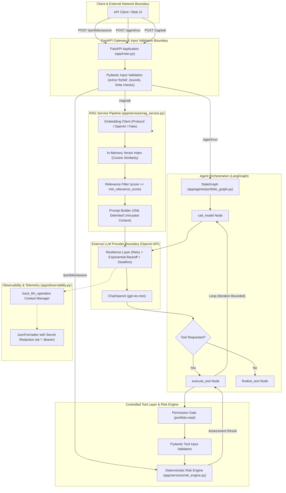
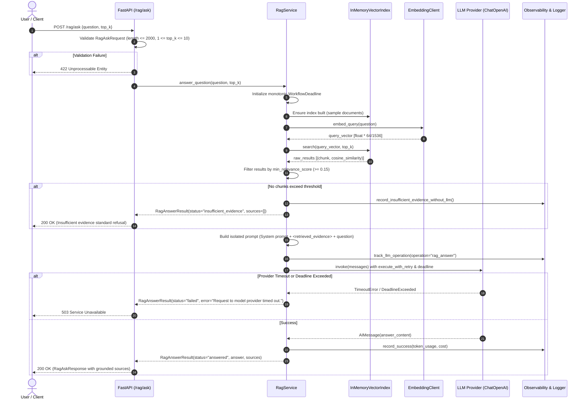
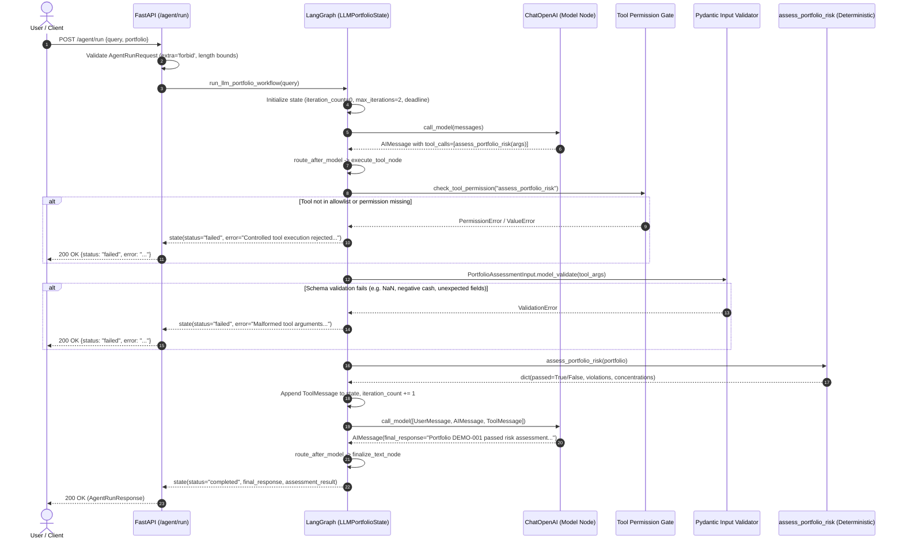

# AlphaPilot AI — System Architecture & Design Specification

## 1. System Overview

**AlphaPilot AI** is an agentic portfolio intelligence and research platform designed to combine:
1. **Deterministic Financial Analysis**: Mathematical precision for portfolio risk assessments, concentration limits, and minimum cash buffer calculations.
2. **LLM-Based Research & Reasoning**: Semantic search and grounded question-answering over investment mandates, compliance guidelines, and policy research documents.

### Why Separate Deterministic Analysis from LLM Reasoning?
Large Language Models (LLMs) are probabilistic token-prediction engines. In financial domains, calculating weights, summing balances, or enforcing regulatory concentration limits with an LLM leads to non-deterministic rounding errors, calculation drift, or potential hallucinations. 

Conversely, rigid programmatic logic cannot answer qualitative policy questions such as *"Under what circumstances can a portfolio breach its cash buffer?"*

AlphaPilot AI addresses this by establishing a strict architectural boundary:
- **Math & Risk Rules**: Executed exclusively by deterministic Python functions validated via Pydantic (`app.services.risk_engine` and `app.tools.portfolio_tools`).
- **Research & Reasoning**: Handled by a controlled LangGraph agent and a grounded RAG pipeline (`app.services.rag_service`), where documents are treated strictly as **untrusted passive evidence** rather than executable instructions.

---

## 2. Component Architecture & System Flow

---

## 3. RAG Query Execution Sequence

The following sequence details how AlphaPilot answers policy research questions while enforcing untrusted data boundaries, source attribution, and timeouts.

---

## 4. Agent Tool-Calling Sequence

The LLM agent does not directly execute Python code or access shell functions. It interacts exclusively through validated schema proposals mediated by LangGraph and application validation gates.

---

## 5. Trust Boundaries & Security Enforcements

| Boundary | Data Flow | Trust Level | Enforced Controls |
| :--- | :--- | :--- | :--- |
| **Client to FastAPI** | HTTP Request Body (`/portfolio/assess`, `/agent/run`, `/rag/ask`) | **Untrusted** | Pydantic v2 schemas, `extra="forbid"`, `min_length=1`, `max_length=2000`, `allow_inf_nan=False`, finite float validation. |
| **FastAPI to Services** | Validated Pydantic Models & Dicts | **Validated / Internal** | Typed function signatures, explicit parameter passing, immutable state dictionaries. |
| **RAG Retrieval to LLM** | Ingested Document Excerpts | **Untrusted Passive Data** | Tagged as untrusted; delimited in prompt; system prompt explicitly forbids following instructions embedded in documents. |
| **LLM Output to System** | Tool call name & arguments | **Untrusted Model Generation** | Tool name allowlist, explicit permission check (`portfolio:read`), strict Pydantic model validation (`PortfolioAssessmentInput`). |
| **System to LLM Provider** | Prompts, Embeddings queries | **Sanitized Outgoing Payload** | API key stored in `SecretStr`, omitted from logs and client responses; timeout and deadline bounded. |
| **Internal Errors to Logs** | Exceptions, Telemetry events | **Diagnostic Internal** | `JsonFormatter` regex masking of `sk-*`, `Bearer *`, auth tokens, passwords, and secrets. |

---

## 6. Scalability and Performance Analysis

### 6.1 Asymptotic Complexity Analysis
- **In-Memory Vector Search**: Linear scan $\mathcal{O}(N \cdot D)$, where $N$ is total chunks indexed and $D$ is embedding dimension (e.g., $D = 64$ for tests, $D = 1536$ for OpenAI). For MVP ($N \approx 50$ chunks), retrieval takes $< 2\text{ ms}$. At $N = 100,000$ chunks, $\mathcal{O}(N \cdot D)$ linear scan would degrade request latency ($> 300\text{ ms}$) and require migrating to an approximate nearest neighbors (ANN) index (e.g., HNSW or IVF).
- **Ingestion & Chunking**: $\mathcal{O}(C)$ where $C$ is document character length. Overlapping chunk sliding window is single-pass $\mathcal{O}(C)$.
- **Risk Engine**: $\mathcal{O}(H)$ where $H$ is the number of holdings in a portfolio ($H \le 500$). The mathematical calculation takes $< 0.1\text{ ms}$.

### 6.2 Latency Characteristics
- **Network Latency to Model Provider**: Typically $500\text{ ms} - 2500\text{ ms}$ per call. Because agent workflows require up to 2 LLM invocations (tool selection + synthesis), end-to-end latency ranges from $1.5\text{ s} - 5.0\text{ s}$.
- **Synchronous Execution**: Currently, LangGraph and RAG workflows execute synchronously on thread workers. While FastAPI endpoints are `async`, internal operations call synchronous clients (`execute_with_retry`). Under high concurrency, worker threads will saturate without an async event loop migration (`ChatOpenAI.ainvoke`).

### 6.3 Shared Mutable State & Multi-Instance Constraints
- `InMemoryVectorIndex` stores chunk vectors inside Python heap memory on a single process.
- **Limitation**: Running multiple uvicorn worker processes (`--workers 4`) or multiple container replicas results in duplicate index memory allocations and independent state. Updating sample documents in one worker does not reflect in others.

---

## 7. Storage and Caching Evolution

```mermaid
graph LR
    subgraph Phase1["Phase 1: Current In-Memory MVP"]
        M1[InMemoryVectorIndex]
        M2[Singleton Process Memory]
    end

    subgraph Phase2["Phase 2: Hybrid Persistent Index"]
        P1[PostgreSQL with pgvector]
        P2[Shared Multi-Instance State]
    end

    subgraph Phase3["Phase 3: Production Enterprise Scale"]
        E1[Managed Vector DB / Pinecone / Qdrant]
        E2[Redis Distributed Embedding Cache]
        E3[S3 / Object Store for Raw PDFs]
    end

    Phase1 -->|"Trigger: Dataset > 50,000 chunks or multi-process replicas"| Phase2
    Phase2 -->|"Trigger: Multi-tenant tenant isolation, > 1M documents"| Phase3
```

### Caching Considerations
1. **Query Embedding Cache**: A hash map keying `SHA256(query_text) -> vector` avoids paying provider API costs for repeated user questions.
2. **Answer Cache**: Caching synthesized answers must be avoided or keyed with strict document revision IDs. Otherwise, if compliance policies change, stale answers could be served.

---

## 8. Prioritized Future Architectural Improvements

1. **Async Migration**: Replace synchronous `invoke()` calls with `ainvoke()` and `asyncio.gather()` to maximize FastAPI async event loop concurrency.
2. **Persistent Storage (pgvector)**: Migrate from in-memory index to PostgreSQL with `pgvector` for cross-process index persistence.
3. **Semantic Query Embedding Cache**: Store deterministic query vectors in Redis with a 24-hour TTL to reduce OpenAI embedding API spend.
4. **Hierarchical Document Ingestion**: Support PDF/HTML document parsers with token-aware chunk boundaries.
